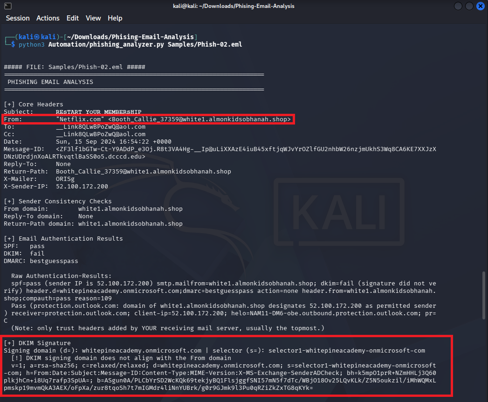
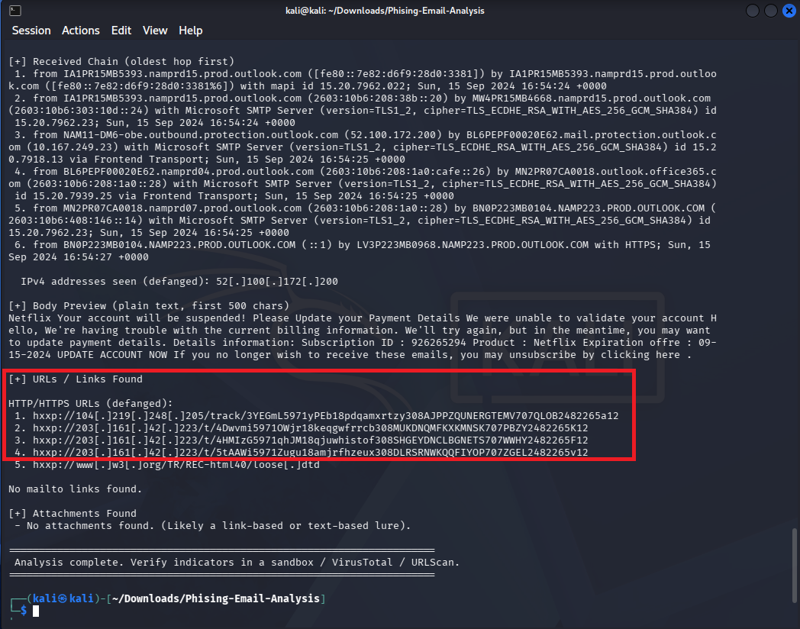
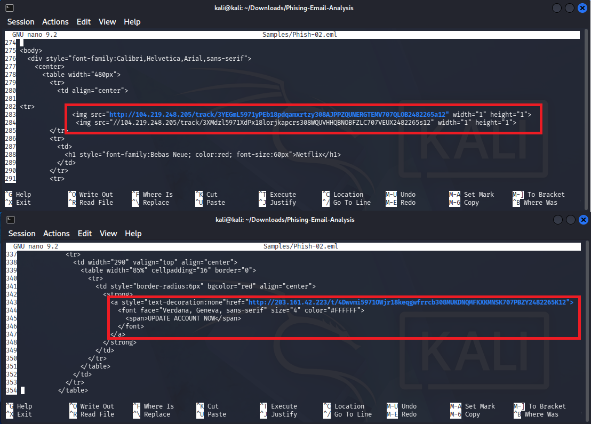

# Phishing Email Analysis Report: Netflix Brand Impersonation & Credential Harvesting

## 1. Executive Summary

| Parameter | Value |
| :--- | :--- |
| **Analysis Date** | October 13, 2026 |
| **Threat Type** | Credential Harvesting / Brand Impersonation |
| **Delivery Method** | Email Web Links (Bare IP Addresses) |
| **Target Brand** | Netflix |
| **Main Phishing Link** | Short-lived Phishing Server (`http://203.161.42.223/t/...`) |
| **Tracking Method** | 1x1 Hidden Tracking Pixel (`http://104.219.248.205/track/...`) |
| **Verdict** | **Confirmed Malicious** |

### Incident Overview
We identified a targeted phishing email pretending to be Netflix billing support with the subject line `"RESTART YOUR MEMBERSHIP"`. The email tries to create a sense of urgency by telling the user their account will be suspended because of a payment issue. By checking the headers, we saw the attacker spoofed the display name and sent the email through a hacked Microsoft 365 account (`whitepineacademy.onmicrosoft.com`) to get past spam filters.

The email does not have any file attachments. Instead, it uses web links. It contains a hidden 1x1 tracking image to check if the user opened the email, and several IP-based links that go to a fake Netflix login page. When we tested the links later, the server was already offline, which is common for quick phishing attacks. However, looking at the code and headers proves this is a malicious email.

---

## 2. Email Header & Authentication Analysis

Initial extraction using the `phishing_analyzer.py` script showed the main email details and authentication headers:

### Core Header Identification
* **Sender Display Name:** `"Netflix.com"`
* **Actual Sender (`From:`):** `Booth_Callie_37359@white1.almonkidsobhanah.shop`
* **Return-Path:** `Booth_Callie_37359@white1.almonkidsobhanah.shop`
* **Sending IP (`X-Sender-IP`):** `52.100.172.200` (Microsoft Outbound Mail Server)
* **Date Sent:** Sun, 15 Sep 2024 16:54:22 +0000

### Authentication Results
* **SPF Check:** `pass` (The sender domain allows the Microsoft IP to send emails on its behalf).
* **DKIM Check:** `fail` (The digital signature does not match the sender domain).
  * **Signing Domain (`d=`):** `whitepineacademy.onmicrosoft.com`
  * **DKIM Alignment:** **Unaligned**. The signature comes from an educational Microsoft 365 account instead of the actual sender domain or Netflix.
* **DMARC Check:** `bestguesspass` (The receiving server did not block it because the sender domain has weak DMARC rules).

**Analyst Note:** The attacker sent the email through a compromised Microsoft 365 school account. Using a trusted Microsoft server helped the email pass SPF checks and land in the user's inbox instead of the spam folder.

---

## 3. Email Body & Link Triage

The automated script found several web links and IP addresses, but no attachments:

### Extracted Indicators
* `hxxp://104[.]219[.]248[.]205/track/3YEGmL5971yPEb18pdqamxrtzy308AJPPZQUNERGTEMV707QLOB2482265a12`
* `hxxp://203[.]161[.]42[.]223/t/4Dwvmi5971OWjr18keqgwfrrcb308MUKDNQMFKXKMNSK707PBZY2482265K12`
* `hxxp://203[.]161[.]42[.]223/t/4HMIzG5971qhJM18qjuwhistof308SHGEYDNCLBGNETS707WWHY2482265F12`
* `hxxp://203[.]161[.]42[.]223/t/5tAAWI5971Zugu18amjrfhzeux308DLRSRNWKQQFIYOP707ZGEL2482265v12`
* `hxxp://www[.]w3[.]org/TR/REC-html40/loose[.]dtd` *(Note: This is just a standard HTML format link and is perfectly safe)*

---

## 4. Source Code Inspection: Tracking vs. Main Link

Since the script just lists all links, I manually checked the raw HTML code in a text editor to see what each link actually does:

### Tracking Pixel (Top Image)
Lines 283–284 show two `img` tags pointing to `104.219.248.205`. 
* **Purpose:** These are hidden 1x1 images. When the email opens, this link loads silently and tells the attacker that the email address is active, along with the user's IP address and device info.

### Main Phishing Link (Bottom Image)
Lines 343–347 show the `UPDATE ACCOUNT NOW` button pointing to `203.161.42.223`. 
* **Purpose:** This is the actual phishing link where the user is supposed to enter their Netflix password and credit card details. Checking the rest of the code showed that clicking the Netflix logo or the "unsubscribe" button also takes the user to this exact same IP.

---

## 5. Threat Intelligence & Infrastructure Checks

I used online tools to check if the destination servers were known for malicious activity.

### URLScan.io Scan
Scanning the main link (`http://203.161.42.223/t/4Dwvmi...`) on URLScan showed the site was unreachable:

* **Result:** `"We could not scan this website!"`
* **Assessment:** The attacker likely already took down the server, or they set it up to block automated security scanners from viewing the page.

### VirusTotal IP Check
Searching the hosting IP `203.161.42.223` on VirusTotal returned a clean status:

* **Score:** `0 / 92` (No security vendor flagged this IP as malicious)
* **Hosting Provider:** Namecheap, Inc.

### Analyst Note on Zero Detections
A clean score on VirusTotal does not mean the link is safe. This setup is very common for evasive phishing attacks:
1. **Bare IP Addresses:** Real companies like Netflix use domain names (like netflix.com), not bare IP numbers for their login pages.
2. **Short Lifespan:** Attackers rent cheap servers and shut them down within a day or two before security companies have time to flag them as malicious.
3. **Blocking Scanners:** Attackers often block IPs from security tools like URLScan and VirusTotal so their fake pages stay hidden longer.

---

## 6. MITRE ATT&CK Mapping

| Tactic | Technique ID | Technique Name | Description |
| :--- | :--- | :--- | :--- |
| **Initial Access** | **T1566.002** | Phishing: Spearphishing Link | Sends an email with a malicious link to steal passwords. |
| **Defense Evasion** | **T1036.005** | Masquerading: Match Legitimate Name | Uses a fake `"Netflix.com"` name to trick the user into trusting the email. |
| **Defense Evasion** | **T1564.008** | Hide Artifacts: Email Hiding Techniques | Uses a hidden 1x1 image to track the user without them knowing. |
| **Resource Development** | **T1584.004** | Compromise Infrastructure: Server | Sends the email through a hacked Microsoft 365 school account to look legitimate. |
| **Reconnaissance** | **T1598.003** | Phishing for Information: Spearphishing Link | Uses unique link paths (`/t/...`) to track exactly who clicked the button. |

---

## 7. Indicators of Compromise (IOCs)

| Type | Indicator | Role in Attack |
| :--- | :--- | :--- |
| **IPv4** | `203.161.42.223` | Main Phishing Server (Where the user enters credentials) |
| **IPv4** | `104.219.248.205` | Tracking Server (Hidden 1x1 pixel) |
| **IPv4** | `52.100.172.200` | Hacked Microsoft 365 Mail Server IP |
| **Domain** | `white1.almonkidsobhanah.shop` | Fake Sender Domain |
| **Domain** | `whitepineacademy.onmicrosoft.com` | Hacked Microsoft 365 Account |
| **URL** | `hxxp://203[.]161[.]42[.]223/t/4Dwvmi...` | Main "Update Account" Link |
| **URL** | `hxxp://104[.]219[.]248[.]205/track/3YEGmL...` | Hidden Tracking Link |

---

## 8. Remediation & Defenses

### Network Defenses
1. **Block IPs:** Add `203.161.42.223` and `104.219.248.205` to the company firewall blocklist.
2. **Block Bare IPs:** Set up web filters to block users from visiting bare IP addresses directly from their browsers, as normal websites use domains.

### Email Security
1. **Block Tracking Images:** Set the company email client (like Outlook) to block automatic picture downloads from external senders to stop tracking pixels.
2. **Check DKIM Alignment:** Set email filters to flag or block emails where the DKIM signature domain does not match the actual sender domain.
3. **Report the Account:** Report the compromised `whitepineacademy.onmicrosoft.com` account to Microsoft so they can lock it down.
