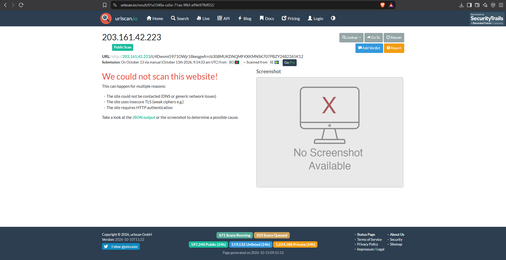
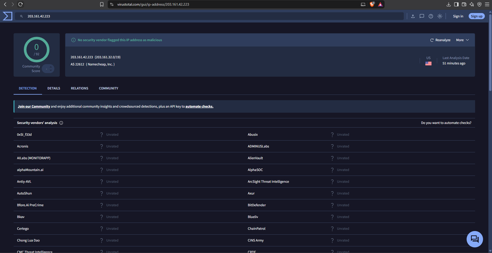

# Phishing Email Analysis Report: Netflix Brand Impersonation & Credential Harvesting

## 1. Executive Summary

| Parameter | Value |
| :--- | :--- |
| **Analysis Date** | October 13, 2026 |
| **Threat Classification** | Credential Harvesting / Brand Impersonation / Defense Evasion |
| **Delivery Vector** | Email-borne Web Links (Bare IP Delivery) |
| **Target Brand** | Netflix |
| **Primary Payload** | Ephemeral Phishing Infrastructure (`http://203.161.42.223/t/...`) |
| **Telemetry / Tracking** | 1x1 Transparent Web Beacon (`http://104.219.248.205/track/...`) |
| **Verdict** | **Confirmed Malicious** |

### Incident Overview
A targeted phishing email was identified impersonating Netflix billing support with the subject line `"RESTART YOUR MEMBERSHIP"`. The lure attempts to induce urgency by claiming account suspension due to payment processing failures. Technical header triage revealed display name spoofing combined with the abuse of a compromised third-party Microsoft 365 tenant (`whitepineacademy.onmicrosoft.com`) to bypass upstream email security controls.

The message contains no file attachments. Instead, it deploys a dual-stage external infrastructure model: an embedded 1x1 reconnaissance web beacon for read validation and multiple bare IPv4 action links directing users to a hosted credential harvesting page. While the target infrastructure was unresponsive during dynamic scanning (indicative of short-lived or evasive hosting), header misalignment and underlying source-code structure definitively confirm malicious intent.

---

## 2. Email Header & Authentication Analysis

Initial automated extraction via `phishing_analyzer.py` parsed key envelope attributes and authentication headers:

### Core Header Identification
* **Sender Display Name:** `"Netflix.com"`
* **Envelope Sender (`From:`):** `Booth_Callie_37359@white1.almonkidsobhanah.shop`
* **Return-Path:** `Booth_Callie_37359@white1.almonkidsobhanah.shop`
* **Originating / Relaying IP (`X-Sender-IP`):** `52.100.172.200` (Microsoft Outbound Protection Relay)
* **Date Sent:** Sun, 15 Sep 2024 16:54:22 +0000

### Authentication Results & Tenant Abuse
* **SPF Check:** `pass` (`white1.almonkidsobhanah.shop` designates `52.100.172.200` as a permitted sender).
* **DKIM Check:** `fail` (Signature did not verify against header domain).
  * **Signing Domain (`d=`):** `whitepineacademy.onmicrosoft.com`
  * **DKIM Alignment:** **Unaligned**. The cryptographic signature originates from an educational Microsoft 365 tenant rather than the envelope domain (`white1.almonkidsobhanah.shop`) or Netflix.
* **DMARC Check:** `bestguesspass` / `action=none` (Recipient MTA did not reject due to permissive DMARC policies on the sender domain).

**Analyst Assessment:** The threat actor routed outbound traffic through a hijacked Microsoft 365 institutional tenant (`whitepineacademy.onmicrosoft.com`). By routing through legitimate Microsoft infrastructure, the email attained an SPF `pass` to facilitate inbox delivery and bypass basic spam filters.

---

## 3. Email Body & Link Triage

Automated extraction identified multiple HTTP endpoints and bare IP indicators with no attached files:

### Extracted Indicators
* `hxxp://104[.]219[.]248[.]205/track/3YEGmL5971yPEb18pdqamxrtzy308AJPPZQUNERGTEMV707QLOB2482265a12`
* `hxxp://203[.]161[.]42[.]223/t/4Dwvmi5971OWjr18keqgwfrrcb308MUKDNQMFKXKMNSK707PBZY2482265K12`
* `hxxp://203[.]161[.]42[.]223/t/4HMIzG5971qhJM18qjuwhistof308SHGEYDNCLBGNETS707WWHY2482265F12`
* `hxxp://203[.]161[.]42[.]223/t/5tAAWI5971Zugu18amjrfhzeux308DLRSRNWKQQFIYOP707ZGEL2482265v12`
* `hxxp://www[.]w3[.]org/TR/REC-html40/loose[.]dtd` *(Excluded: Benign W3C DTD schema reference)*

---

## 4. Deep Source Inspection: Tracking vs. Payload Differentiation

Because basic URI scraping does not establish behavioral context, manual source analysis was performed directly on the raw email body in a text editor:

### Telemetry / Reconnaissance Beacon (Upper Panel)
Lines 283–284 embed two `img` tags pointing to `104.219.248.205`:
* **Tag Implementation:** ``
* **Purpose:** Transparent 1x1 image tracking pixel (web beacon).
* **Mechanism:** When the victim's client renders HTML images, an automated GET request logs recipient verification, client IP, timestamp, and User-Agent telemetry back to the attacker.

### Primary Credential Lure (Lower Panel)
Lines 343–347 wrap the call-to-action button (`UPDATE ACCOUNT NOW`) around `203.161.42.223`:
* **Tag Implementation:** `<a href="http://203.161.42.223/t/4Dwvmi59...">UPDATE ACCOUNT NOW</a>`
* **Purpose:** Interactive credential harvesting portal.
* **Mechanism:** Directs victims to an external web form designed to capture Netflix credentials and payment details. Source review confirmed all interactive elements (including the logo and unsubscribe prompt) point to tracking routes on this same host.

---

## 5. Threat Intelligence & Infrastructure Pivoting

Dynamic triage and multi-engine reputation checks were performed against the destination hosting infrastructure.

### URLScan.io Detonation
Submission of the primary lure URL (`http://203.161.42.223/t/4Dwvmi...`) to URLScan.io resulted in an unreachable host status:

* **Result:** `"We could not scan this website!"`
* **Status:** Site unreachable / No HTTP response.
* **Assessment:** The attacker utilized short-lived, ephemeral infrastructure that was deactivated shortly after email transmission, or configured access controls to drop traffic from known analysis datacenters.

### VirusTotal IP Reputation
Querying host IP `203.161.42.223` on VirusTotal returned a clean status across all security vendors:

* **Score:** `0 / 92` (No security vendor flagged this IP as malicious)
* **ASN:** `AS 22612 (Namecheap, Inc.)`
* **Geo Location:** United States

### Analytical Assessment on Zero Detections
Zero-vendor detection in automated engines does not signify a benign message. The infrastructure exhibits classic hallmarks of **evasive/bulletproof hosting**:
1. **Bare IP Addressing:** Legitimate commercial services do not route users to raw IPv4 addresses over unencrypted HTTP (`http://203.161.42.223`) for sensitive account administration.
2. **Short Operational Lifetime:** Phishing actors spin up cheap virtual private servers or proxies (hosted here on Namecheap infrastructure) for bursts of 12–48 hours and abandon them before reputation algorithms can process them.
3. **Bot/Scanner Filtering:** Modern phishing toolkits routinely filter incoming connections by User-Agent, geo-location, or datacenter IP blocks, dropping connections from automated platforms (like URLScan) while remaining active for targeted victims.

---

## 6. MITRE ATT&CK Mapping

| Tactic | Technique ID | Technique Name | Description |
| :--- | :--- | :--- | :--- |
| **Initial Access** | **T1566.002** | Phishing: Spearphishing Link | Employs an email lure containing links to actor-controlled infrastructure to harvest credentials. |
| **Defense Evasion** | **T1036.005** | Masquerading: Match Legitimate Name | Uses `"Netflix.com"` in the display name to disguise malicious sender identity. |
| **Defense Evasion** | **T1564.008** | Hide Artifacts: Email Hiding Techniques | Embeds a 1x1 transparent image beacon to stealthily validate victim engagement. |
| **Resource Development** | **T1584.004** | Compromise Infrastructure: Server | Routes campaign traffic through a compromised educational Microsoft 365 tenant. |
| **Reconnaissance** | **T1598.003** | Phishing for Information: Spearphishing Link | Deploys tokenized link paths (`/t/...`) to track specific victim click rates. |

---

## 7. Indicators of Compromise (IOCs)

| Type | Indicator | Attribution / Role |
| :--- | :--- | :--- |
| **IPv4** | `203.161.42.223` | Phishing Host / Credential Harvester (AS22612) |
| **IPv4** | `104.219.248.205` | Tracking Pixel / Telemetry Web Beacon |
| **IPv4** | `52.100.172.200` | Microsoft 365 Relay IP (Compromised Tenant Route) |
| **Domain** | `white1.almonkidsobhanah.shop` | Attacker Sender Domain |
| **Domain** | `whitepineacademy.onmicrosoft.com` | Hijacked Microsoft 365 Tenant (DKIM Signer) |
| **URL** | `hxxp://203[.]161[.]42[.]223/t/4Dwvmi...` | Primary Phishing CTA Endpoint |
| **URL** | `hxxp://104[.]219[.]248[.]205/track/3YEGmL...` | Email Open Telemetry Web Beacon |

---

## 8. Remediation & SOC Recommendations

### Perimeter & Network Defense
1. **Network Ingress Blocking:** Add `203.161.42.223` and `104.219.248.205` to perimeter firewall and web proxy blocklists.
2. **Block Bare IP Navigation:** Enforce enterprise web gateway rules that block direct outbound HTTP/HTTPS connections to raw IP addresses that lack fully qualified domain names (FQDNs).
3. **External Image Blocking:** Enforce default mail client policies (e.g., Outlook / Exchange) to block automatic downloading of remote images and web beacons from external senders.

### Mail Security & Tenant Hardening
1. **DKIM Alignment Enforcement:** Configure mail gateway filters to flag or quarantine incoming messages where the DKIM signing domain does not match the header `From:` domain, particularly when originating from generic `.onmicrosoft.com` tenants.
2. **Tenant Compromise Reporting:** Submit an abuse report to Microsoft Security Operations regarding the compromised educational tenant `whitepineacademy.onmicrosoft.com` to facilitate tenant containment and credential resets.
