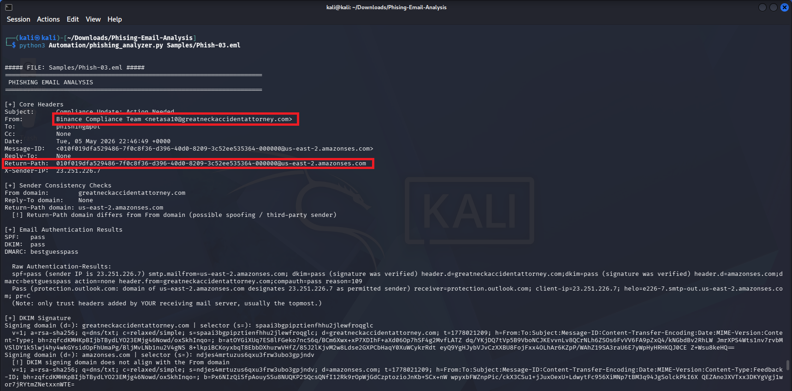
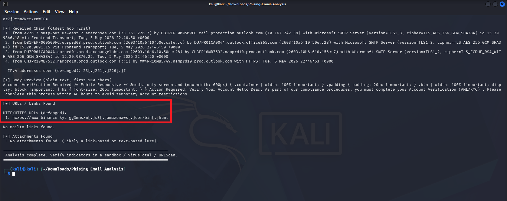
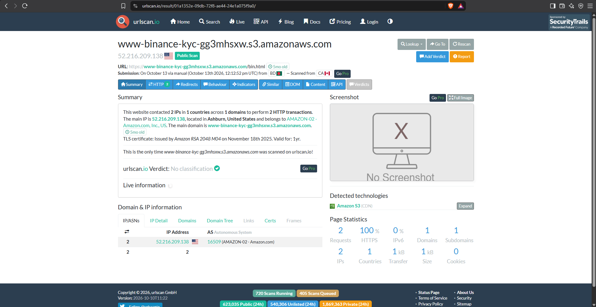
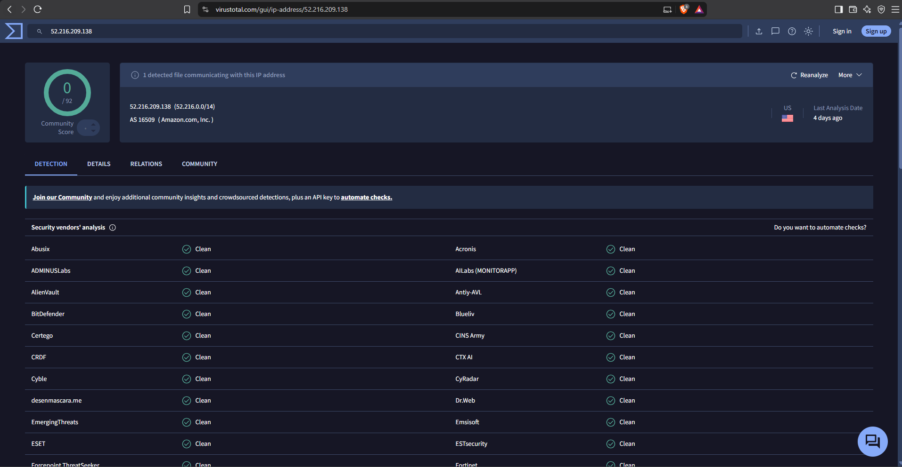

# Phishing Email Analysis Report: Binance Impersonation & Cloud Infrastructure Abuse

## 1. Executive Summary

| Parameter | Value |
| :--- | :--- |
| **Analysis Date** | October 13, 2026 |
| **Threat Type** | Credential Harvesting / Cloud Abuse |
| **Delivery Method** | Email Web Link |
| **Target Brand** | Binance |
| **Main Phishing Link** | Amazon S3 Bucket (`hxxps://www-binance-kyc...s3.amazonaws.com`) |
| **Sending Infrastructure**| Amazon Simple Email Service (SES) |
| **Verdict** | **Confirmed Malicious** |

### Incident Overview
We identified a targeted phishing email pretending to be the "Binance Compliance Team." The email claims the user needs to complete an account verification (KYC) within 48 hours to avoid account restrictions. 

The attacker used a highly effective evasion tactic: abusing legitimate cloud services. They sent the email using Amazon's official email service (Amazon SES) and hosted the fake Binance login page on an Amazon S3 storage bucket. Because the email and the link both come from trusted Amazon servers, this attack easily bypasses basic spam filters and security scanners. Despite passing automated checks, manual analysis confirms this is a credential harvesting attempt.

---

## 2. Email Header & Authentication Analysis

Initial extraction using the `phishing_analyzer.py` script showed how the attacker spoofed the sender details:

### Core Header Identification
* **Sender Display Name:** `"Binance Compliance Team"`
* **Actual Sender (`From:`):** `netasa10@greatneckaccidentattorney.com`
* **Return-Path (Real Sender):** `...@us-east-2.amazonses.com`
* **Sending IP (`X-Sender-IP`):** `23.251.226.7` (Amazon SES Server)
* **Date Sent:** Tue, 05 May 2026 22:46:49 +0000

### Authentication Results
* **SPF Check:** `pass` (The email was sent from an official Amazon IP, which is allowed).
* **DKIM Check:** `pass` (The email has a valid signature from Amazon SES).
* **DMARC Check:** `bestguesspass`

**Analyst Note:** The attacker is not actually hacking Binance or Amazon. They created a free Amazon AWS account and used Amazon Simple Email Service (SES) to send the spam. They spoofed the display name to say "Binance," but used a compromised attorney's domain (`greatneckaccidentattorney.com`) in the "From" field. Because the email physically came from a real Amazon server, the SPF and DKIM security checks passed.

---

## 3. Email Body & Link Triage

The automated script found one primary web link and no file attachments:

### Extracted Indicators
* `hxxps://www-binance-kyc-gg3mhsxw[.]s3[.]amazonaws[.]com/bin[.]html`

**Analyst Note:** This link points directly to an HTML file hosted on an Amazon S3 bucket. The attacker named the bucket `www-binance-kyc` to make the URL look legitimate to an untrained user. 

---

## 4. Threat Intelligence & Infrastructure Checks

To confirm the status of the payload, I checked the Amazon S3 link and IP using online threat intelligence tools.

### URLScan.io Scan
Scanning the S3 bucket link on URLScan showed the page is no longer active:

* **Main IP:** `52.216.209.138` (Belongs to Amazon.com)
* **Technology:** Amazon S3 (CDN)
* **Result:** No screenshot available (Site down or unreachable).
* **Assessment:** The attacker likely deleted the S3 bucket after their phishing campaign ended, or Amazon's security team found it and took it down. 

### VirusTotal IP Check
Searching the hosting IP `52.216.209.138` on VirusTotal returned a clean status:

* **Score:** `0 / 92` (Clean)
* **Hosting Provider:** Amazon.com, Inc.

### Analyst Note on Cloud Abuse
The IP address shows as 100% clean on VirusTotal because it is a shared Amazon server. Security companies cannot blacklist this IP, because doing so would block thousands of legitimate businesses that use Amazon Web Services. The attacker specifically chose to host their fake page on Amazon to take advantage of this "trusted" reputation and evade detection.

---

## 5. MITRE ATT&CK Mapping

| Tactic | Technique ID | Technique Name | Description |
| :--- | :--- | :--- | :--- |
| **Initial Access** | **T1566.002** | Phishing: Spearphishing Link | Sends an email with a malicious link to steal cryptocurrency credentials. |
| **Defense Evasion** | **T1036.005** | Masquerading: Match Legitimate Name | Uses `"Binance Compliance Team"` to trick the user into trusting the email. |
| **Resource Development** | **T1584.004** | Compromise Infrastructure: Server | Uses a compromised domain (`greatneckaccidentattorney.com`) for the sender address. |
| **Resource Development** | **T1583.001** | Acquire Infrastructure: Domains | Abuses legitimate cloud services (Amazon SES and Amazon S3) to host and send the attack. |

---

## 6. Indicators of Compromise (IOCs)

| Type | Indicator | Role in Attack |
| :--- | :--- | :--- |
| **URL** | `hxxps://www-binance-kyc-gg3mhsxw[.]s3[.]amazonaws[.]com/bin[.]html` | Phishing Page (AWS S3 Bucket) |
| **IPv4** | `23.251.226.7` | Amazon SES Sending IP |
| **Domain** | `greatneckaccidentattorney.com` | Compromised Sender Domain |
| **Email** | `netasa10@greatneckaccidentattorney.com` | Sender Email Address |

---

## 7. Remediation & Defenses

### Network Defenses
1. **Cloud Access Broker (CASB):** Implement network rules to inspect traffic going to generic cloud storage URLs (like `.s3.amazonaws.com` or `storage.googleapis.com`) for unauthorized login portals.

### Email Security
1. **Sender Alignment:** Configure email security gateways to quarantine emails where the Display Name says a major financial brand (like Binance), but the actual sending domain does not match the brand.
2. **Report Abuse:** Report the malicious S3 bucket URL and the abuse of the Amazon SES sending IP to AWS Trust & Safety so they can permanently ban the attacker's AWS account.
