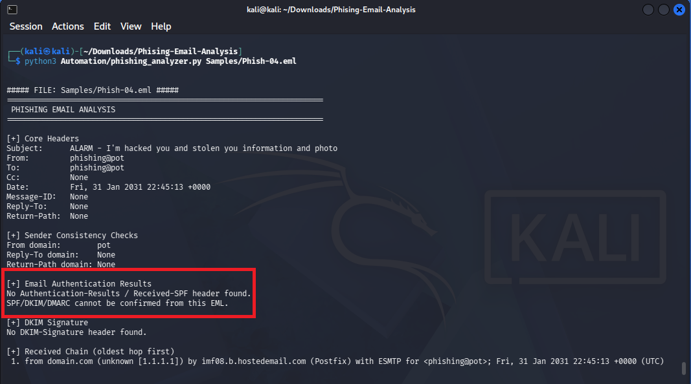
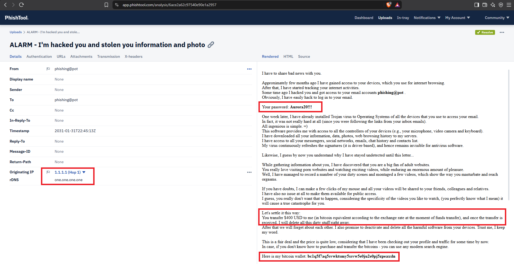
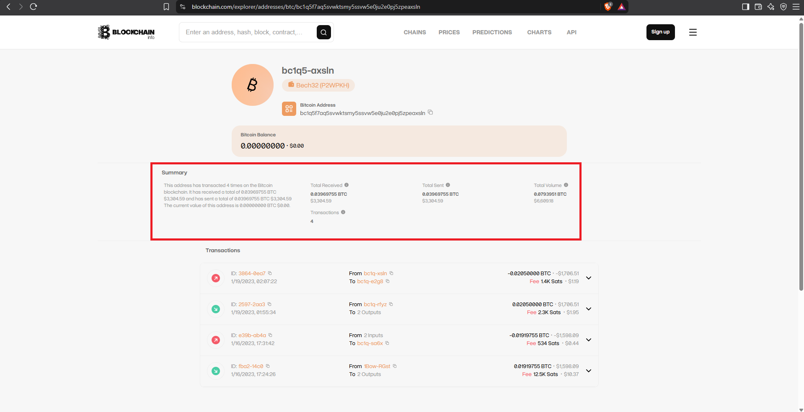

# Phishing Email Analysis Report: Sextortion & Credential Stuffing

## 1. Executive Summary

| Parameter | Value |
| :--- | :--- |
| **Analysis Date** | October 13, 2026 |
| **Threat Type** | Sextortion / Credential Stuffing / Social Engineering |
| **Delivery Method** | Plaintext Email |
| **Target** | Honeypot Recipient |
| **Primary Payload** | Cryptocurrency Extortion (Bitcoin) |
| **Verdict** | **Confirmed Malicious** |

### Incident Overview
We identified a social engineering email attempting a sextortion scam. The attacker claims to have infected the user's devices with a Trojan, recorded compromising video, and stolen their data. To prove their access, the attacker includes a plaintext password (`Aurora20!!!`) that belongs to the user. The attacker demands $400 USD in Bitcoin to prevent the release of the supposed videos.

**Methodology Note on Sanitization:** This artifact was sourced from a sanitized intelligence honeypot. The original victim and attacker email addresses were scrubbed and replaced with the `phishing@pot` placeholder prior to analysis. 

Despite the alarming claims, technical analysis confirms there is no actual malware infection. The attacker utilized "Credential Stuffing"—taking an old, compromised password from a public data breach and emailing it to the victim to create a false sense of legitimacy and induce panic.

---

## 2. Tooling Rationale & Triage Strategy

Because this specific threat lacks traditional technical payloads (no hidden HTML redirects, malicious JavaScript, or weaponized attachments), the analysis strategy shifted from pure code inspection to visual social engineering triage. **PhishTool** was utilized alongside custom CLI scripts to properly map the attacker's psychological framework and financial demands within a unified SOC dashboard view.

---

## 3. Email Header & Authentication Analysis

Initial analysis using the `phishing_analyzer.py` script revealed severe header anomalies, indicating the email was forged and sent outside normal corporate infrastructure.

### Core Header Identification
* **Sender / Recipient:** `phishing@pot` to `phishing@pot`
* **Originating IP:** `1.1.1.1` (Spoofed Cloudflare DNS IP)
* **Date Sent:** Fri, 31 Jan 2031 22:45:13 +0000

### Authentication Results
* **SPF/DKIM Checks:** Completely missing from the headers (`No Authentication-Results / Received-SPF header found`, `No DKIM-Signature header found`).

**Analyst Note on Self-Spoofing:** The attacker forged the `From` address to exactly match the victim's `To` address. This "self-spoofing" tactic is designed to trick the victim into believing the attacker actually has access to their email account. Furthermore, the complete lack of SPF/DKIM signatures and the spoofed `1.1.1.1` originating IP indicate the attacker used an open SMTP relay or a script to inject the message directly, bypassing standard email authentication protocols.

---

## 4. Email Body & Social Engineering Triage

To visualize the extortion payload, the artifact was loaded into **PhishTool** for GUI-based triage. There were no attachments or malicious web links present.

### Social Engineering Indicators
* **Credential Stuffing:** The attacker explicitly lists the password `"Aurora20!!!"`. 
* **Fear Motivation:** Threats of releasing adult content to family and coworkers.
* **Extortion Demand:** A strict demand for `$400 USD` paid in cryptocurrency.
* **Cryptocurrency IOC:** Bitcoin Wallet `bc1q5f7aq5svwktsmy5ssvw5e0ju2e0pj5zpeaxsln`.
* **Infrastructure Obfuscation:** PhishTool confirms the originating IP (`1.1.1.1`) belongs to Cloudflare's public DNS resolver, proving the attacker spoofed the origin to hide their true server location.

---

## 5. Threat Intelligence & Blockchain Investigation

Because there were no domains or IP payloads to scan in URLScan or VirusTotal, threat intelligence pivoting was performed on the financial payload: the Bitcoin wallet address.

### Blockchain.com Explorer
A search of the wallet address (`bc1q5f7aq5svwktsmy5ssvw5e0ju2e0pj5zpeaxsln`) on the public blockchain revealed active financial movement:

* **Total Received:** `0.03969755 BTC` (Approximately `$3,304.59 USD`)
* **Current Balance:** `0.00000000 BTC` ($0.00)
* **Transaction Count:** 4 Transactions 

**Analyst Assessment:** The blockchain ledger confirms that this wallet is part of an active, successful extortion campaign. The attacker successfully received over $3,300 in payments. The zero-dollar current balance indicates that the attacker immediately transfers incoming victim funds to secondary wallets to launder the cryptocurrency and avoid seizure. 

---

## 6. MITRE ATT&CK Mapping

| Tactic | Technique ID | Technique Name | Description |
| :--- | :--- | :--- | :--- |
| **Initial Access** | **T1566.001** | Phishing: Spearphishing Attachment/Link | Uses fear-based email lures to extort the victim, though relying on text rather than links. |
| **Defense Evasion** | **T1036.005** | Masquerading: Match Legitimate Name | Self-spoofs the victim's own email address to feign account compromise. |
| **Reconnaissance** | **T1598.002** | Phishing for Information: Spearphishing Link | Leverages breached credentials ("Credential Stuffing") gathered from earlier external data leaks. |
| **Impact**
