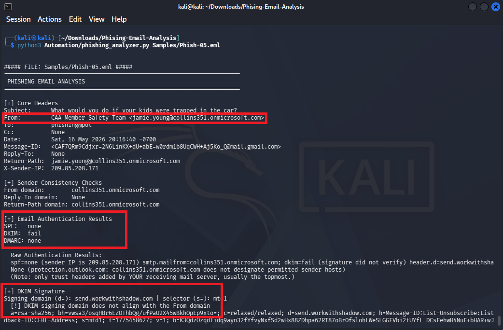
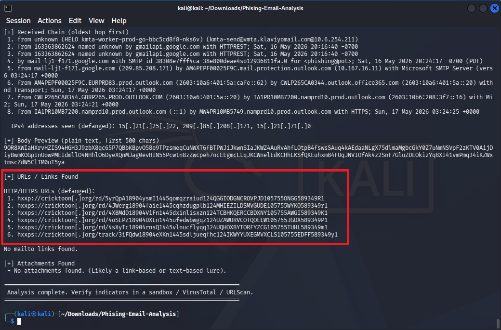
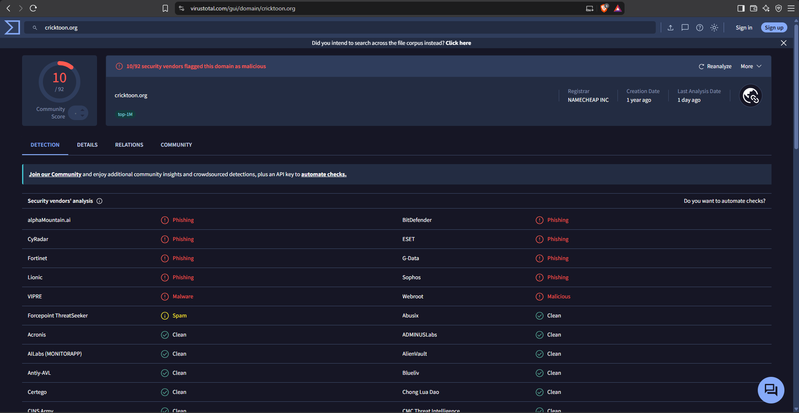
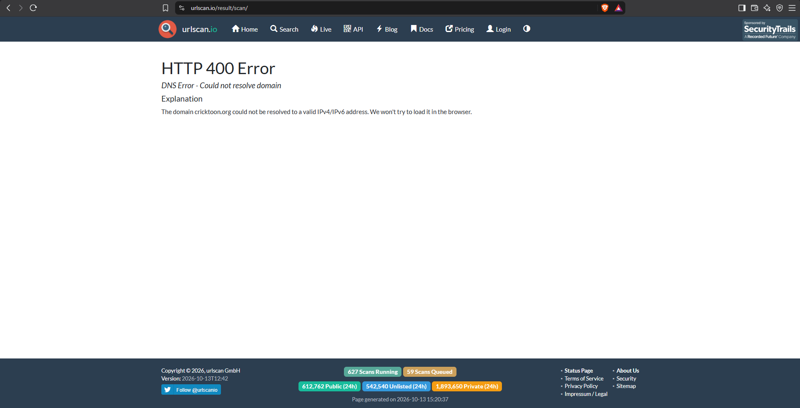

# Phishing Email Analysis Report: Brand Impersonation & Fear-Based Lure

## 1. Executive Summary

| Parameter | Value |
| :--- | :--- |
| **Analysis Date** | October 13, 2026 |
| **Threat Type** | Brand Impersonation / Social Engineering |
| **Delivery Method** | Email Web Link |
| **Targeted Brand** | Canadian Automobile Association (CAA) |
| **Primary Payload** | Malicious Redirect (`cricktoon[.]org`) |
| **Verdict** | **Confirmed Malicious** |

### Incident Overview
We identified a highly manipulative phishing campaign impersonating the "CAA Member Safety Team." The attacker utilized fear-based social engineering, fabricating a story about children trapped in a freezing car to create a sense of urgency. The email pushes the recipient to click a link to purchase an "Emergency Safety Tool." 

Technical analysis reveals the attacker spoofed the display name, routed the email through mismatched third-party infrastructure, and utilized a defense evasion technique known as "Hash Busting" to bypass spam filters. All links within the email direct the user to a confirmed malicious domain.

**Methodology Note:** This artifact was sourced from a sanitized intelligence honeypot. The original recipient address was scrubbed and replaced with the `phishing@pot` placeholder prior to analysis.

---

## 2. Email Header & Authentication Analysis

Initial analysis using the `phishing_analyzer.py` script highlighted severe discrepancies between the visible sender and the actual sending infrastructure.

### Core Header Identification
* **Sender Display Name:** `CAA Member Safety Team`
* **Actual Sender (`From:`):** `jamie.young@collins351.onmicrosoft.com`
* **Sending IP:** `209.85.208.171`

### Authentication Results
* **SPF Check:** `none`
* **DKIM Check:** `fail` (Signature did not verify)

**Analyst Note on Infrastructure Abuse:** The attacker spoofed the CAA brand in the display name but sent the email from a random, likely compromised Microsoft 365 tenant (`collins351.onmicrosoft.com`). Furthermore, the DKIM signature completely failed, revealing the email was actually routed through a third-party domain (`send.workwithshadow.com`). This total lack of alignment confirms the sender is fraudulent.

---

## 3. Email Body & Defense Evasion

Script analysis of the email body revealed a significant defense evasion tactic alongside the malicious payload.

### Defense Evasion: Hash Busting (Bayesian Poisoning)
The script extracted a massive, continuous block of randomized text (e.g., `9OR8XWIaHXrvHZIS94...`) hidden within the raw email body. 
* **Analyst Insight:** This is a technique known as **Hash Busting** or **Bayesian Poisoning**. Attackers inject invisible, randomized strings of text into an email to alter its file hash and dilute malicious keywords. This is done specifically to trick AI-driven spam filters and evade signature-based detection mechanisms.

### Extracted Indicators
* `hxxps://cricktoon[.]org/rd/...`
Despite the email containing multiple links disguised as "Unsubscribe", "Privacy Policy", and the main "Safety Tool" button, every single link redirects the user to the exact same malicious domain (`cricktoon.org`).

---

## 4. Threat Intelligence Investigation

To determine the risk level of the payload, the destination domain (`cricktoon.org`) was investigated using external threat intelligence platforms.

### VirusTotal Analysis
A scan of the root domain confirmed its malicious nature across multiple security vendors:

* **Score:** `10 / 92` flagged as malicious.
* **Threat Categories:** Flagged explicitly for **Phishing** and **Malware** by major vendors including BitDefender, ESET, and Sophos.

### URLScan.io Infrastructure Status
A live scan of the domain was performed to capture the current state of the phishing page:

* **Result:** `HTTP 400 Error` / `DNS Error - Could not resolve domain`.
* **Analyst Assessment:** The attacker's infrastructure has been neutralized. The domain `cricktoon.org` no longer resolves to an active IP address, indicating that the domain registrar has suspended the account or the attacker has burned the infrastructure following the conclusion of the campaign.

---

## 5. MITRE ATT&CK Mapping

| Tactic | Technique ID | Technique Name | Description |
| :--- | :--- | :--- | :--- |
| **Initial Access** | **T1566.002** | Phishing: Spearphishing Link | Delivers malicious links via a fear-based social engineering lure. |
| **Defense Evasion** | **T1036.005** | Masquerading: Match Legitimate Name | Impersonates the Canadian Automobile Association (CAA) to build trust. |
| **Defense Evasion** | **T1027.001** | Obfuscated Files or Information: Padding | Uses "Hash Busting" (invisible randomized text) to bypass Bayesian spam filters and alter file signatures. |

---

## 6. Indicators of Compromise (IOCs)

| Type | Indicator | Role in Attack |
| :--- | :--- | :--- |
| **Domain** | `cricktoon[.]org` | Primary malicious redirect / phishing payload |
| **Domain** | `collins351.onmicrosoft.com` | Compromised sender tenant |
| **Email** | `jamie.young@collins351.onmicrosoft.com` | Fraudulent sender address |
| **Domain** | `send.workwithshadow.com` | Mismatched DKIM routing infrastructure |

---

## 7. Remediation & SOC Recommendations

### Network & Email Defenses
1. **Domain Blocking:** Add `cricktoon[.]org` and `*.cricktoon[.]org` to network blocklists and DNS sinkholes to prevent any retroactive clicks by users.
2. **Authentication Enforcement:** Configure the email security gateway to aggressively quarantine emails that fail DKIM alignment checks, especially when the display name mimics a known, trusted brand.

### User Awareness
1. **Phishing Simulation Update:** Incorporate **fear-based lures** (e.g., family emergencies, immediate physical threats) into the next round of employee phishing training. Employees must be taught that attackers actively use emotional manipulation to bypass logical scrutiny.
